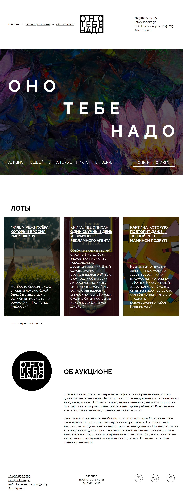

# Оно тебе надо

Одностраничный сайт аукциона вещей, в которые никто не верил. Учебная проектная работа Яндекс Практикума.

## О проекте

Страница свёрстана по макету из Figma с проверкой через Pixel Perfect. Ширина макета — 1100px.

Разделы страницы:

- **Шапка** - меню, логотип и контакты.
- **Обложка** - большой заголовок на фоне картины с затемнением и кнопка «Сделать ставку».
- **Лоты** - три карточки с фоновыми изображениями.
- **Об аукционе** - логотип в круге и текст о проекте.
- **Подвал** - контакты, меню и ссылки на соцсети.

## Структура

```
├── fonts/      - шрифты и их подключение
├── images/     - изображения и иконки
├── styles/
│   ├── global.css  - сброс и общие стили
│   └── style.css   - стили страницы
└── index.html
```

## Скриншоты



## Как открыть

Склонируйте репозиторий и откройте `index.html` в браузере:

```
git clone https://github.com/bmelnikov02/ono-tebe-nado-ad.git
```